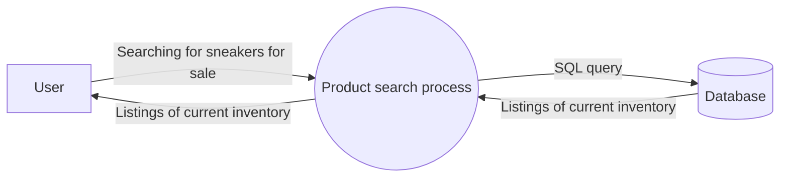
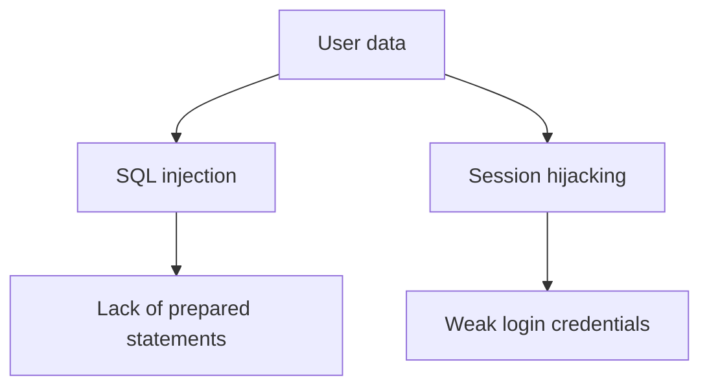

# PASTA Threat Model: Sneaker Marketplace Mobile App

**Framework:** Process of Attack Simulation and Threat Analysis (PASTA)
**Scenario:** Security team member performing a threat model for a new mobile app where customers buy and sell sneakers.

---

## Stage I: Define Business and Security Objectives
- **Transactions:** The app processes payments between buyers and sellers, so payment handling must be accurate, fast, and secure, with several payment options.
- **Data privacy and legal compliance:** The app stores personal and payment data. It must protect user privacy and meet payment regulations (e.g., PCI DSS) to avoid legal issues.
- **User accounts and communication:** Users must be able to sign up, log in, manage accounts, message sellers, and rate them, all without exposing user data.

## Stage II: Define the Technical Scope
**Technologies:** API, PKI, AES, RSA, SHA-256, SQL

**Prioritized technology: SQL**
I would evaluate SQL first because the app's database stores user accounts, seller information, and sneaker listings, and it is queried during every search and purchase. Poorly written queries expose this data to SQL injection, one of the most common and damaging web application attacks, so securing it protects everything else.

## Stage III: Decompose the Application
Data flow diagram (product search process):

User input enters the search process and is passed to the SQL database. This is the point where unsanitized input could be abused.

## Stage IV: Threat Analysis
1. **SQL injection (external threat):** An attacker enters malicious SQL code in a search or login field to read, modify, or delete data in the database.
2. **Session hijacking (external threat):** An attacker steals or takes over an active user session and accesses the account, messages, and payment information.

## Stage V: Vulnerability Analysis
1. **Lack of prepared statements:** Queries built from raw user input allow SQL injection (codebase/database weakness).
2. **Weak login credentials:** Weak or reused passwords make accounts easy to guess or brute force, which enables session hijacking and account takeover (authentication weakness).

## Stage VI: Attack Modeling

## Stage VII: Risk Analysis and Impact
Security controls to reduce the risk of a data breach:
1. **Prepared statements (parameterized queries):** Prevent SQL injection by separating code from user input.
2. **Multi-factor authentication (MFA):** Protects accounts even if a password is stolen or guessed.
3. **Strong password policy:** Enforces complexity and length, and blocks weak or reused passwords.
4. **Principle of least privilege:** Limits what each user, service, and database account can access, reducing the impact of a compromise.

*Additional ideas:* input validation, salted SHA-256 password hashing, AES encryption of payment data, regular penetration testing.
